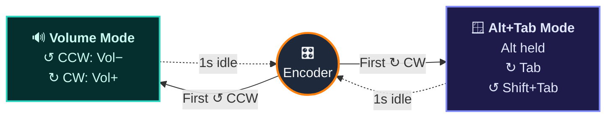

# ZMK-Orbit

[🇬🇧 English](README.md) | [🇹🇷 Türkçe](README-TR.md) 

Tek Encoder, İki Farklı Mod!    
ZMK-Orbit, tek bir encoder'a ek tuş, layer veya kombinasyon kullanmadan iki farklı çalışma modu kazandırır.     
Encoder'ı ilk çevirdiğiniz yön, hangi modun etkinleşeceğini belirler. Mod aktifken encoder'ın her iki yönü de farklı işlemler gerçekleştirir.


# Kurulum ve Yapılandırma

Öncelikle modülü config/west.yml dosyanıza ekleyin:     

```yaml
manifest:
  remotes:
    - name: ozkan
      url-base: https://github.com/ozkan

  projects:
    - name: zmk-orbit
      remote: ozkan
      revision: main
      path: modules/zmk-orbit

``` 

Ardından keymap dosyanızda behavior tanımını ekleyin:

```dts
/ {
    behaviors {
        orbit: orbit {
            compatible = "zmk,behavior-orbit";
            #sensor-binding-cells = <0>;

            clockwise = <TAB>, <LS(TAB)>;
            counter-clockwise = <C_VOLUME_UP>, <C_VOLUME_DOWN>;

            clockwise-keep-mods = <LEFT_ALT>;

            timeout-ms = <1000>;
        };
    };
};
```

Son olarak orbit behavior'ını kullanmak istediğiniz layer'ın sensor-bindings alanına ekleyin:

```dts
sensor-bindings = <&orbit>;
```

## Nasıl Çalışır? (örnek uygulama)


### 1 Alt+Tab Modu
Encoder'ı ilk kez saat yönünde çevirdiğinizde bu mod etkinleşir.        

- Saat yönünde çevirme: Alt + Tab     
- Saat yönünün tersine çevirme: Alt + Shift + Tab     
- Alt tuşu, işlem boyunca basılı tutulur.     
(Windows'ta açık uygulamalar arasında geçiş yapmak için kullanılır.)  

### 2 Ses Seviyesi Kontrol Modu
Encoder'ı ilk kez saat yönünün tersine çevirdiğinizde bu mod etkinleşir.    

- Saat yönünde çevirme: Ses seviyesini artırır.       
- Saat yönünün tersine çevirme: Ses seviyesini azaltır.       
     
## Modun Sıfırlanması

Her iki modda da son encoder hareketinden sonra 1 saniye boyunca hareketsizlik olduğunda işlem tamamlanır.  
- Aktif mod sona erer ve basılı tutulan modifier tuşları bırakılır.   
- Sonraki encoder hareketi yeni bir işlem başlatır.   
- Yeni mod, ilk hareketin yönüne göre belirlenir. 


**Notlar:**

`clockwise` ve `counter-clockwise` özellikleri tam olarak iki tuş tanımı içermelidir.   
`clockwise-keep-mods` ve `counter-clockwise-keep-mods` modifier tanımları isteğe bağlıdır. 
Tanımlanmadığında ilgili modda modifier basılı tutulmaz.        
`timeout-ms` değerini değiştirerek modun ne kadar süre aktif kalacağını ayarlayabilirsiniz.   


## License
MIT


