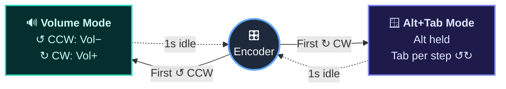

# ZMK-Orbit

One Encoder. Multiple Functions.    
No extra layers or click gymnastics required: spin clockwise to window-hop, counter-clockwise to tweak volume, and pause for a second to start fresh.  




**Rule:** The operating mode is selected automatically by the first encoder movement, stays locked until the action finishes, and resets after 1 second of inactivity.      
A custom ZMK sensor behavior that turns a rotary encoder into a dual-purpose controller:

- **↻ Alt-Tab window switching**
- **↺ System volume control**


## Features

### 1. Window Switching Mode

Turn the encoder **clockwise first** to activate window switching mode.

| Encoder direction | Action |
|---|---|
| Clockwise | `Alt + Tab` — Next window |
| Counter-clockwise | `Alt + Shift + Tab` — Previous window |

- `Alt` is held while switching between windows.
- Each encoder movement sends a Tab keystroke.
- `Alt` is automatically released after 1 second of inactivity.

### 2. Volume Control Mode

Turn the encoder **counter-clockwise first** to activate volume mode.

| Encoder direction | Action |
|---|---|
| Clockwise | Volume Up |
| Counter-clockwise | Volume Down |

- Uses standard HID Consumer Control commands.
- Each movement sends an individual volume command.
- No keys remain held after an action.

### Mode Selection & Reset

The first encoder movement determines the operating mode:

- First clockwise movement → Window switching mode.
- First counter-clockwise movement → Volume control mode.
- The selected mode remains locked until the session ends.
- After **1 second of inactivity**, the behavior resets to idle.
- The next movement can select a different mode.

## Installation

Add the module to your `config/west.yml`:

```diff
manifest:
  remotes:
    - name: zmkfirmware
      url-base: https://github.com/zmkfirmware

+    - name: ozkan
+      url-base: https://github.com/ozkan

  projects:
    - name: zmk
      remote: zmkfirmware
      revision: main
      import: app/west.yml

+    - name: zmk-orbit
+      remote: ozkan
+      revision: main
+      path: modules/zmk-orbit

  self:
    path: config
```

## Configuration

Add the behavior to your keymap:

```dts
/ {
    behaviors {
        orbit: orbit {
            compatible = "zmk,behavior-orbit";
            #sensor-binding-cells = <0>;
            timeout-ms = <800>;
        };
    };
};
```

Bind it to your encoder:

```dts
sensor-bindings = <&orbit>;
```

### Configuration Options

| Property | Default | Description |
|---|---:|---|
| `timeout-ms` | `1000` | Inactivity timeout before returning to idle mode |

## Compatibility

Designed primarily for Windows using standard keyboard and Consumer Control HID commands. Other operating systems may require different shortcut handling.

## License

MIT