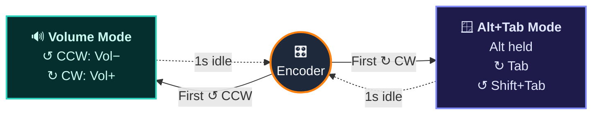

# ZMK-Orbit

[🇬🇧 English](README.md) | [🇹🇷 Türkçe](README-TR.md) 

**One Encoder. Multiple Functions.**

Turn one way to select a mode, then use both encoder directions for different actions. No extra layers or click gymnastics required.

ZMK-Orbit is a configurable ZMK sensor behavior that turns a rotary encoder into a dual-mode controller. Each mode has its own clockwise and counter-clockwise key mappings, with optional modifiers that remain held throughout the session.

## How It Works (example)




**Mode selection rule:**

- First clockwise movement selects the clockwise mode.
- First counter-clockwise movement selects the counter-clockwise mode.
- The first movement also executes its corresponding action.
- The selected mode remains locked until the inactivity timeout expires.
- When the session ends, all held modifiers are released and the behavior returns to idle.

## Features

### 1. Two Independent Modes

Each mode has two configurable key mappings:

| Active mode | Encoder direction | Key mapping |
|---|---|---|
| Clockwise mode | Clockwise | `clockwise[0]` |
| Clockwise mode | Counter-clockwise | `clockwise[1]` |
| Counter-clockwise mode | Clockwise | `counter-clockwise[0]` |
| Counter-clockwise mode | Counter-clockwise | `counter-clockwise[1]` |

Each encoder step sends an individual key tap.

### 2. Persistent Modifier Support

Each mode can optionally hold one or more modifiers throughout its session.

- Modifiers are pressed once when a mode is selected.
- They remain held while the encoder is used in either direction.
- Individual key taps are sent without releasing the held modifiers.
- All held modifiers are released when the session times out.

This makes combinations such as `Alt + Tab`, `Alt + Shift + Tab`, or other modifier-based shortcuts possible without pressing the modifier again for every encoder step.

### 3. Automatic Session Reset

- The default inactivity timeout is **1000 ms**.
- Every encoder movement restarts the timeout.
- When the timeout expires, held modifiers are released and the mode resets to idle.
- The next encoder movement can select either mode.

## Installation

Add the module to your `config/west.yml`:

```yaml
manifest:
  remotes:
    - name: zmkfirmware
      url-base: https://github.com/zmkfirmware

    - name: ozkan
      url-base: https://github.com/ozkan

  projects:
    - name: zmk
      remote: zmkfirmware
      revision: main
      import: app/west.yml

    - name: zmk-orbit
      remote: ozkan
      revision: main
      path: modules/zmk-orbit

  self:
    path: config
```

## Configuration

Add the behavior to your keymap:

```dts
/ {
    behaviors {
        orbit: orbit {
            compatible = "zmk,behavior-orbit";
            #sensor-binding-cells = <0>;

            clockwise = <TAB>, <LS(TAB)>;
            counter-clockwise = <C_VOLUME_UP>, <C_VOLUME_DOWN>;

            clockwise-keep-mods = <LEFT_ALT>;

            timeout-ms = <1000>;
        };
    };
};
```

Bind it to your encoder:

```dts
sensor-bindings = <&orbit>;
```

With this example:

| First movement    | Subsequent direction  | Action |
|-------------------|-----------------------|--------|
| Clockwise         | Clockwise             |  `Alt + Tab` |
| Clockwise         | Counter-clockwise     | `Alt + Shift + Tab` |
| Counter-clockwise | Clockwise             | Volume Up |
| Counter-clockwise | Counter-clockwise     | Volume Down |

`LEFT_ALT` is pressed once when clockwise mode starts and remains held until the session ends. Volume mode does not hold any modifiers.

## Configuration Options

| Property | Required | Default | Description |
|----------|----------|---------|-------------|
| `clockwise` | Yes | — | Two keycodes: clockwise action first, counter-clockwise action second, when clockwise mode is active. |
| `counter-clockwise` | Yes | — | Two keycodes: clockwise action first, counter-clockwise action second, when counter-clockwise mode is active. |
| `clockwise-keep-mods` | No | None | Modifier keycodes held throughout clockwise mode. |
| `counter-clockwise-keep-mods` | No | None | Modifier keycodes held throughout counter-clockwise mode. |
| `timeout-ms` | No | `1000` | Inactivity timeout before returning to idle mode. |

**Important:**
- Both action properties must contain exactly two keycodes.
- In each pair, the first keycode is for clockwise rotation and the second is for counter-clockwise rotation.
- Modifier properties accept one or more keycodes.
- If a modifier property is omitted, no modifiers are held in that mode.

## Customization Examples
These examples illustrate the configurable mappings; the actual keycodes and shortcuts depend on the host operating system.


**Mac switching and volume control:**

```dts
clockwise = <TAB>, <LS(TAB)>;
counter-clockwise = <C_VOLUME_UP>, <C_VOLUME_DOWN>;
clockwise-keep-mods = <LEFT_GUI>;
```

**Custom shortcut mode: (Spotify Playback Control Mode)**

```dts
clockwise = <LC(RIGHT)>, <LC(LEFT)>;   // ↻ Skip to the next track. ↺ Skip to the previous track.
counter-clockwise = <C_VOLUME_UP>, <C_VOLUME_DOWN>;  // ↺ Volume down.  ↻ Volume up.
timeout-ms = <800>; // Exit the custom shortcut mode after 800 ms of inactivity.
```


## Compatibility

ZMK-Orbit uses standard ZMK keycode state events and sensor bindings. Key mappings and modifier behavior depend on the HID support and shortcut conventions of the host operating system.

## License

MIT